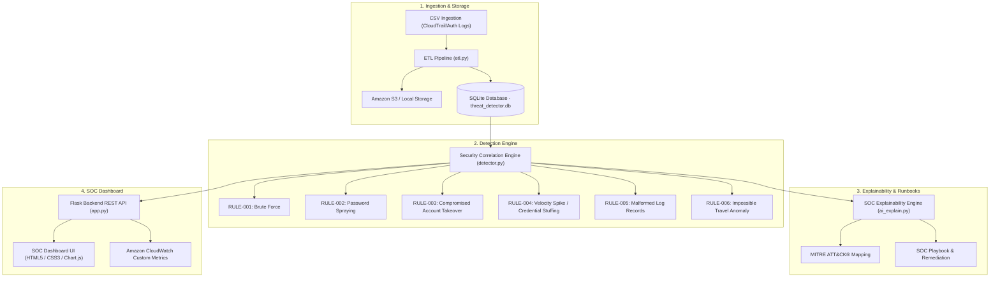
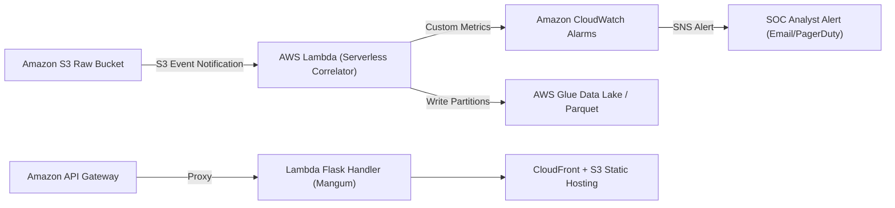

# Cloud Security Threat Detector — Architecture Specification

## 1. System Overview

The **Cloud Security Threat Detector** is an enterprise-grade Security Operations Center (SOC) monitoring and correlation platform developed for the **Wipro COE – WE CPPE** Capstone project. It ingests multi-source authentication logs, cleanses and normalizes security records through a robust ETL pipeline, executes explainable correlation heuristics to detect sophisticated adversary attacks, calculates risk scores (0–100), and presents actionable triage runbooks for security analysts.

---

## 2. Component Architecture

### 2.1 Backend Services
- **Flask REST API (`app.py`)**: Central application orchestrator providing endpoints for dashboard analytics, incident querying, status transitions, and CSV export.
- **SQLite Database (`database.py`)**: High-performance local persistence using parameterized queries to eliminate SQL injection vulnerabilities.
- **ETL Pipeline (`etl.py`)**: Extract-Transform-Load module normalizing diverse timestamp standards (ISO-8601, Epoch, standard date strings), validating IPv4 formats, deduplicating records, and handling malformed rows.
- **Detection Engine (`detector.py`)**: Deterministic correlation engine evaluating time-windowed authentication patterns using Pandas.
- **Explainability Engine (`ai_explain.py`)**: Local deterministic SOC reasoning engine mapping alerts to MITRE ATT&CK tactics and retrieving targeted containment actions.
- **AWS Integration Service (`aws_integration.py`)**: Boto3 client wrapper with offline simulation mode designed for AWS Academy Learner Lab environments.

---

## 3. Explainable Risk Scoring Model

The risk score $R \in [0, 100]$ is computed using a deterministic, multi-factor heuristic formula:

$$R = \min\left(100, \left( \text{BaseScore} + 4 \cdot \log_2(\text{Attempts}) + \text{Bonus}_{\text{Privileged}} \right) \times \text{VelocityFactor}\right)$$

Where:
- **$\text{BaseScore}$**: Intrinsic severity of the violated rule (e.g., 68 for Brute Force, 75 for Spraying, 90 for Breach post-failure).
- **$\text{Attempts}$**: Number of correlated anomalous events observed within the sliding time window.
- **$\text{Bonus}_{\text{Privileged}}$**: Added $+15$ points if the targeted identity matches privileged keywords (`root`, `admin`, `devops`, `cloudadmin`).
- **$\text{VelocityFactor}$**: Multiplier ($1.1\times$) for short-burst frequency spikes.

### Severity Classification
- **Critical (85–100)**: Immediate credential compromise or multi-region breach indicator.
- **High (65–84)**: Targeted brute-force attacks or horizontal password spraying.
- **Medium (40–64)**: Anomalous request bursts or repetitive malformed telemetry.
- **Low (0–39)**: Isolated formatting errors or low-volume anomalies.

---

## 4. Cloud Migration Strategy (AWS Academy & Enterprise Production)

1. **Log Storage**: Move local CSV uploads to S3 bucket with server-side AES-256 encryption (`aws:kms` or `AES256`).
2. **Serverless Execution**: Package Flask application using `Mangum` adapter or deploy lightweight microservices on AWS Lambda triggered by S3 `ObjectCreated` events.
3. **Big Data Processing**: Scale large volume VPC Flow Logs and CloudTrail archives using AWS Glue 4.0 (Spark 3.3) via `etl_pyspark_pipeline.py`.
4. **Monitoring & Alerting**: CloudWatch custom metrics emit `ThreatsDetectedCount`, triggering CloudWatch Alarms connected to Amazon SNS topic notifications.
